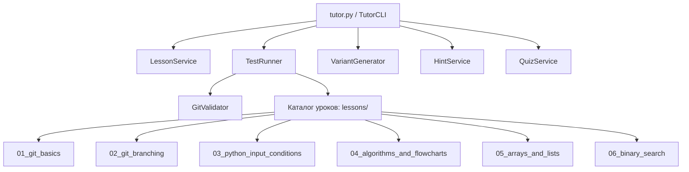

# UML-диаграмма архитектуры обучающего тренажёра

> Автоматически поддерживаемая диаграмма компонентов и классов платформы.
> Формат: Mermaid Class Diagram & Component Architecture.

---

## 🏛️ Архитектура компонентов системы

---

## 🧩 Диаграмма классов предметной области

```mermaid
classDiagram
    class DifficultyLevel {
        <<enumeration>>
        BASE
        STANDARD
        ADVANCED
    }

    class Lesson {
        +int index
        +str slug
        +str title
        +Path path
        +str description
        +List~DifficultyLevel~ available_levels
    }

    class TestResult {
        +bool success
        +int total_tests
        +int passed_tests
        +str message
        +str diff_details
    }

    class Hint {
        +int level
        +str title
        +str content
    }

    class QuizQuestion {
        +str question
        +List~str~ options
        +int correct_idx
        +str explanation
    }

    class BaseService {
        <<abstract>>
        +Logger log
    }

    class LessonService {
        +Path lessons_root
        +get_all_lessons() List~Lesson~
        +get_lesson_by_index(index) Lesson
        +get_exercise_file(lesson, level) Path
        +get_hints_file(lesson) Path
        +get_quiz_file(lesson) Path
    }

    class TestRunner {
        +run_tests(lesson, level) TestResult
        -_execute_test_suite(tests_file, exercise_file, level) TestResult
        -_import_module_from_path(name, path) ModuleType
    }

    class VariantGenerator {
        +generate_variant(identifier, lesson_idx) dict
        -_get_seed_from_identifier(identifier) int
        -_gen_git_basics(rng, name, seed) dict
        -_gen_conditions(rng, name, seed) dict
        -_gen_binary_search(rng, name, seed) dict
    }

    class HintService {
        +load_hints(file) List~Hint~
        +get_hint_by_level(hints, level) Hint
        +format_hint(hint) str
    }

    class QuizService {
        +load_quiz(file) List~QuizQuestion~
        +ask_question(index, q) bool
        -_get_valid_input(max_options) int
        -_display_feedback(is_correct, exp) void
    }

    class GitValidator {
        +validate_basics(repo_dir) TestResult
        +validate_branching(repo_dir) TestResult
        -_run_git_cmd(repo_dir, args) str
    }

    BaseService <|-- LessonService
    BaseService <|-- TestRunner
    BaseService <|-- VariantGenerator
    BaseService <|-- HintService
    BaseService <|-- QuizService
    BaseService <|-- GitValidator

    LessonService ..> Lesson : creates
    TestRunner ..> TestResult : returns
    HintService ..> Hint : manages
    QuizService ..> QuizQuestion : evaluates
    Lesson *-- DifficultyLevel
```

